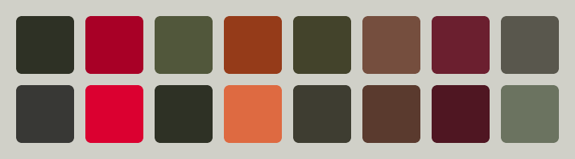
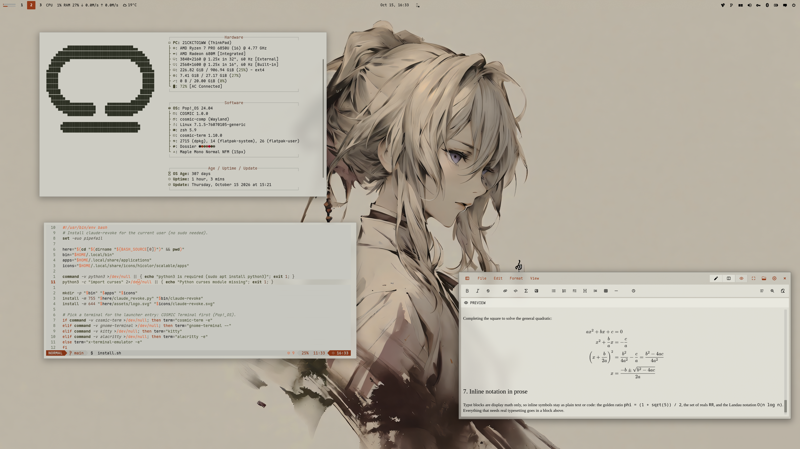
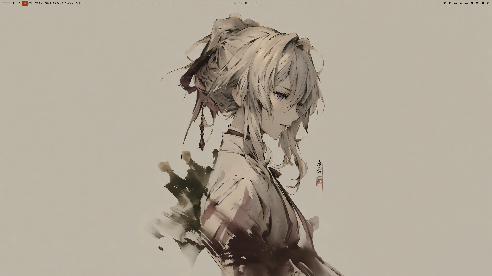

<div align="center">

# COSMIC · Dossier



Pop!_OS 24.04 on COSMIC in stone grey, olive and rust: desktop, terminal,
shell, Firefox, Brave, cursor, wallpapers. The light half of a pair; the dark half is
[cosmic-noir-theme](https://github.com/atraxsrc/cosmic-noir-theme).


</div>

---


## Palette

From the Omarchy [The Greek](https://github.com/HANCORE-linux/omarchy-thegreek-theme)
theme: manila-grey paper, dark olive, a rust accent. Text roles use the
upstream's darker rust and a deeper red so everything reads at 4.5:1 or
better on the window background; the brighter upstream orange stays for the
terminal cursor and btop highlights. As in the original, the terminal is an
opaque pane a step darker than the desktop, and the window border is a thin
grey edge rather than an accent.

| Role | Color | Hex |
|------|-------|-----|
| Background |  Stone |  `#D0D0C8` |
| Containers |  Paper / Card |  `#DCDCD4` /  `#E4E4DC` |
| Terminal |  Pane |  `#C7C7C0` |
| Text |  Ink |  `#242424` |
| Accent |  Rust |  `#953B19` |
| Highlight |  Orange (cursor, btop highlights) |  `#DE6A41` |
| Success |  Olive |  `#51573B` |
| Warning |  Brown |  `#754E3E` |
| Error |  Red |  `#A80026` |
| Khaki |  Directories |  `#43432B` |
| Wine |  Symlinks |  `#6B1F2F` |
| Muted |  Secondary text |  `#59574D` |
| Border |  Window hint |  `#6C6C64` |
| Dim |  Comments |  `#6B7360` |

| Role | Dossier | Noir |
|------|---------|------|
| Background |  `#D0D0C8` |  `#171717` |
| Text |  `#242424` |  `#CCD0CF` |
| Accent |  `#953B19` |  `#F25623` |
| Success |  `#51573B` |  `#88A57D` |

---

## Repo Structure

```
.
├── brave
│   ├── theme                    # Chromium theme (manifest + icons), Load unpacked
│   └── README.md
├── btop
│   └── Dossier.theme            # btop colour theme
├── claude-desktop
│   ├── cosmic-noir.jsonc        # Claude Desktop theme (claude-desktop-extra), dark + light
│   └── install.sh
├── cosmic
│   ├── Dossier.ron              # COSMIC Appearance import (Light)
│   ├── config/                  # baseline settings: fonts, icons, terminal look
│   └── install.sh
├── cosmic-term
│   └── Dossier-term.ron         # COSMIC Terminal colour scheme (Light)
├── cursors
│   ├── Oxygen-Dossier-*/         # cursor themes, one per icon colour, patched for COSMIC apps
│   ├── install.sh
│   ├── uninstall.sh
│   └── README.md
├── icons
│   └── install.sh               # Cosmic-Dossier icon pack from cosmic-icon-themes
├── fastfetch
│   ├── config.jsonc             # rust / khaki fastfetch config
│   ├── cosmic.txt               # COSMIC logo
│   └── install.sh
├── firefox
│   ├── theme                    # Cosmic Dossier theme add-on (manifest + icons)
│   ├── chrome
│   │   ├── userChrome.css       # rounded chrome, paper menus, rust hover
│   │   └── userContent.css      # new tab accents, blank tiles
│   ├── install.sh
│   └── README.md
├── lsd
│   ├── config.yaml              # theme: custom
│   ├── colors.yaml              # permission / size / date / git columns
│   └── install.sh
├── nvim                         # Neovim colorscheme, LazyVim spec, RON syntax, install.sh
├── telegram
│   ├── colors.tdesktop-theme    # Telegram Desktop colour scheme (source)
│   ├── cosmic-dossier.tdesktop-theme  # built theme, open this in Telegram
│   └── build.sh                 # rebuilds it, optionally with a wallpaper
├── vscode
│   ├── themes/                  # Cursor / VS Code colour themes, Noir (dark) + Dossier (light)
│   ├── package.json             # extension manifest
│   ├── install.sh               # packs a .vsix, installs it with cursor --install-extension
│   └── README.md
├── scripts
│   ├── update_system.sh         # nala + flatpak, dark ANSI for a light terminal
│   └── switch.sh                # make this the active rice (see Switching rice)
├── zsh
│   ├── dossier.zsh              # LS_COLORS, highlighting colours, aliases, starship
│   └── install.sh
├── assets
│   ├── cursors/                 # cursor preview
│   ├── palette.png              # the 16 terminal colours, under the title
│   ├── screenshot.png           # README screenshot
│   └── wallpaper.png            # the ink portrait on the bare desktop
├── backgrounds/                 # wallpapers, dossier-<subject>.png (see Icons and wallpaper)
├── docs
│   └── showcase.md              # the rice describing itself, for the Postilla pane of the screenshot
├── LICENSE
└── README.md
```

---

## COSMIC Desktop

This is a **Light** theme, so it goes in COSMIC's Light slot:

Settings → Desktop → Appearance → **Light** → **Import** → `cosmic/Dossier.ron`

Accent is rust  `#953B19`; the window hint border is the mid neutral  `#6C6C64`,
a thin grey edge like the Omarchy original instead of an accent ring.
Use the `+` control if you want a custom swatch.

Frosted glass is on in the `.ron` at `frosted: Low` with an opacity table of
0.66 to 0.96, tinted with the palette's middle neutral, for windows, panel,
applets and system UI (maximized apps stay solid), and corners are squared
(`radius_*: 2.0`), the same as the DarkGold baseline. Adjust frosted glass on
Appearance → Style → Frosted glass after import; those sliders survive a theme switch.

Export from Appearance if you tweak backgrounds / tints so you do not lose them.

Pairing tip: import `Noir.ron` from
[cosmic-noir-theme](https://github.com/atraxsrc/cosmic-noir-theme) into the
Dark slot and COSMIC's Dark / Light toggle flips between the two. Wallpaper,
Firefox and the shell layer do not follow the toggle; those are per-rice files.

### Baseline settings

`cosmic/config/` holds the settings that make up the look and rarely change
(panel, dock, applets and shortcuts are left out on purpose):

| Where | Setting |
|-------|---------|
| Fonts | Interface `Maple Mono Normal`, monospace `Maple Mono Normal NFM` |
| Icons | Cosmic-Dossier-Rust |
| Windows | Minimize / maximize buttons hidden, theme applied to GNOME apps |
| Terminal | Maple Mono 15 (weights 500 / bold 800 / dim 300), opaque, no header bar, Dossier (light scheme) |

Install the [Maple fonts](https://github.com/subframe7536/maple-font/releases)
(Maple Mono Normal and Maple Mono Normal NFM) and the Cosmic-Dossier icons (see
Icons below) and import the terminal scheme first, then:

```bash
./cosmic/install.sh
```

It backs up each file it replaces to `*.bak` and COSMIC applies it live.

---

## COSMIC Terminal

The desktop `.ron` does not colour ANSI text.

1. COSMIC Terminal → **View → Color schemes…** (not Settings → Appearance)
2. **Light** tab → **Import** → `cosmic-term/Dossier-term.ron`
3. View → Settings → Appearance → Color scheme (light) → **Dossier**

If a profile is set as default, set the scheme on that profile too or the
dropdown will look like it did nothing.

Ink text on an opaque pane  `#C7C7C0`, a step darker than the desktop like the
Omarchy original; red for errors, olive for strings and success, rust in the
yellow slot, khaki for directories, wine for cyan. Bright colours are deeper,
dim colours lighter, so bold and dim still read on a light background. On the
pane rust, brown and muted land at 4.2 to 4.3:1, a little under the 4.5:1 the
window background keeps; drop the `background` line from the scheme to get the
window colour back.

---

## Firefox

Two layers:

1. **Theme (colours):** install
   **[cosmic-dossier-theme on addons.mozilla.org](https://addons.mozilla.org/en-US/firefox/addon/cosmic-dossier-theme/)**.
   This is the main look.
2. **Stylesheets (optional):** `firefox/chrome/` adds rounded corners, rust
   menu hover, rust accents and blank new-tab tiles on top of the add-on
   (they also work with Firefox's built-in Light theme):

```bash
./firefox/install.sh
```

Fully quit Firefox afterward. Details and CSS rules: [`firefox/README.md`](firefox/README.md).

---

## Brave

`brave/theme` is a Chromium theme with the Firefox theme's colours: stone
frame, paper toolbar, olive icons and inactive tabs, rust on the active tab.
Brave, Chrome, Chromium and Edge take it, and it loads straight from the
clone, so no Chrome Web Store or Google account is needed:

`brave://extensions` → **Developer mode** → **Load unpacked** → `brave/theme`

Leave the clone in place, Brave keeps reading the folder. Colours, limits and
packing a `.crx`: [`brave/README.md`](brave/README.md).

---

## Claude Desktop

For the unofficial [claude-desktop-extra](https://github.com/patrickjaja/claude-desktop-extra)
Linux build. `claude-desktop/cosmic-noir.jsonc` is one theme with both halves:
Noir in dark mode and Dossier in light mode, so Claude's own
Settings → Appearance toggle switches between the two rices.
Colours come from `cosmic/*.ron`, contrast-checked (text and button text
4.5:1, accents 3:1).

```bash
./claude-desktop/install.sh
```

It copies the file into `~/.config/Claude/themes.d/`. Then press
<kbd>Ctrl</kbd>+<kbd>Shift</kbd>+<kbd>T</kbd> in Claude Desktop and pick **cosmic-noir**.

The same file ships in [`cosmic-noir-theme`](https://github.com/atraxsrc/cosmic-noir-theme),
so installing from either repo gives the same theme.

---

## Cursor editor

`vscode/` is a colour theme extension for [Cursor](https://cursor.com) with
both halves of the pair: **Cosmic Noir** and **Cosmic Dossier**. It is a plain
VS Code theme extension, so VS Code and VSCodium take it too, and the same
folder ships in cosmic-noir-theme. Code is coloured the way Neovim is in
each rice; the workbench takes the desktop's window and container colours,
with the accent on the active tab, buttons and menu highlight, and the
integrated terminal uses the COSMIC Terminal scheme. Cursor builds its Agent
and chat panels from the same theme colours, so they follow along.

```bash
./vscode/install.sh
```

It packs `vscode/` into a `.vsix` and installs it with
`cursor --install-extension`; run it again after editing the theme. Then press
<kbd>Ctrl</kbd>+<kbd>K</kbd> <kbd>Ctrl</kbd>+<kbd>T</kbd> in Cursor and pick
**Cosmic Dossier**. Three lines in Cursor's `settings.json` make it follow
COSMIC's Dark / Light toggle between Noir and Dossier; they, the colours and
the contrast notes are in [`vscode/README.md`](vscode/README.md).

---

## Telegram

`telegram/cosmic-dossier.tdesktop-theme` is a Telegram Desktop theme: stone
chat list and background, paper incoming and pale-olive outgoing bubbles, rust
for the accent, links, unread badges and buttons (with stone text on them),
olive for online status and read ticks. Group member names use the rice's
terminal colours. Text and badge colours are contrast-checked at 4.5:1 or
better, except disabled menu items.

Settings → Chat Settings → Chat wallpaper → **Choose from file** →
`telegram/cosmic-dossier.tdesktop-theme` → **Apply this theme**.

The colours live in `telegram/colors.tdesktop-theme`, which is plain text;
`build.sh` zips it with the chat background into the `.tdesktop-theme`. The
background is the plain window colour; to put a wallpaper behind the chat instead
(ImageMagick re-encodes it to a 2560px JPEG, Telegram caps theme files at 5 MB):

```bash
./telegram/build.sh --wallpaper backgrounds/dossier-anime.png
```

Built against Telegram Desktop 7.3.1. Calls, group calls, statistics charts and
premium badges keep Telegram's own colours.

Telegram has no dark / light pairing, so Noir, the dark half, ships its own
theme.

---

## Cursor

**Oxygen** cursors recoloured to the icon colours, one per folder colour of the
Cosmic-Dossier icon pack: **Rust** (default), **Olive**, **Ink**. Patched with the cursor
names COSMIC apps ask for. COSMIC has no cursor picker yet, so the script sets it:

```bash
./cursors/install.sh                      # Rust
./cursors/install.sh --variant Olive     # or another, see --list
reboot
```

Previews, what the script touches, how to undo it and how the colours are made:
[`cursors/README.md`](cursors/README.md).

---

## Scripts

### `update_system.sh`

nala + flatpak updater. Headers in olive-black, info in khaki, success in
olive, errors in red; the banner ramps from olive-black to khaki. All dark
enough for a light terminal.

```bash
chmod +x scripts/update_system.sh
./scripts/update_system.sh
```

### `switch.sh`

Makes this the active rice, coming from any other `cosmic-*-theme` rice. See
[Switching rice](#switching-rice).

```bash
./scripts/switch.sh
```

---

## Terminal extras

Need a [Nerd Font](https://www.nerdfonts.com/) in the terminal for the icons
(Maple Mono NFM in the baseline above).

### zsh

`zsh/dossier.zsh` is the rice part of the shell only: `LS_COLORS` (also used
by lsd for file names and by the completion menu), rust / olive / red colours
for zsh-autosuggestions and zsh-syntax-highlighting, lsd / bat / nvim aliases
and the starship prompt. Your own `~/.zshrc` stays private and sources it.

Needs zsh + [oh-my-zsh](https://ohmyz.sh/). `install.sh` clones the two
plugins if missing and appends one `source` line to `~/.zshrc` (backup in
`~/.zshrc.bak`):

```bash
./zsh/install.sh
exec zsh
```

In `~/.zshrc` keep `ZSH_THEME=""` and
`plugins=(git sudo zsh-autosuggestions zsh-syntax-highlighting)`.

### lsd

File names are coloured by `LS_COLORS` from `zsh/dossier.zsh`;
`lsd/colors.yaml` colours the other columns with the 256-colour codes nearest
the palette (130 rust, 58 olive, 88 red, 95 brown, 240 khaki, 241 muted,
245 dim). lsd 1.0.0 does not accept `#hex` there.

```bash
./lsd/install.sh
lsd -l
```

### fastfetch

COSMIC logo in olive-black, Hardware / Software / Age boxes in pale grey with
khaki keys. `install.sh` backs up any existing `~/.config/fastfetch/config.jsonc`
to `config.jsonc.bak`.

```bash
./fastfetch/install.sh
fastfetch
```

### Neovim

`nvim/` carries the rice into Neovim: a dependency-free colorscheme built from
the palette (`nvim/colors/dossier.lua`), a LazyVim spec that selects it and makes
sure the treesitter parsers for the files in this repo are installed
(`nvim/lua/plugins/dossier.lua`), and a small RON syntax file so `cosmic/*.ron`
is coloured even before the parser exists. `:terminal` inside Neovim uses the
Dossier scheme.

```bash
./nvim/install.sh
# restart nvim; LazyVim switches to the dossier colorscheme
```

Without LazyVim, copy `nvim/colors/dossier.lua` to `~/.config/nvim/colors/` and
run `:colorscheme dossier`.

### btop

`btop/Dossier.theme`: terminal background, dark olive boxes, orange highlights,
meters ramp from olive through rust to red.

```bash
mkdir -p ~/.config/btop/themes
cp btop/Dossier.theme ~/.config/btop/themes/
# btop → Esc → Options → Color theme → Dossier
```

---

## Icons and wallpaper

Icons: **Cosmic-Dossier**, the [Kanagawa icons](https://github.com/Fausto-Korpsvart/Kanagawa-GKT-Theme/tree/main/icons/Kanagawa)
by Fausto Korpsvart recolored to this palette in
[cosmic-icon-themes](https://github.com/atraxsrc/cosmic-icon-themes). Folders come in
three colors: **Rust**  `#953B19` (default), **Olive**  `#51573B` and **Ink**  `#242424` with orange symbols.


```bash
./icons/install.sh                  # Rust folders
./icons/install.sh --variant Olive  # or Ink
```

It downloads the pack from the latest cosmic-icon-themes release, checks its SHA256,
installs it to `~/.local/share/icons/` and sets it as the COSMIC icon theme.
Restart open apps afterwards (Files caches icons per window).
Add `--system` to install to `/usr/share/icons` instead, for every user and the
login screen (asks for sudo); `--user` is the default.

Wallpapers ship in [`backgrounds/`](backgrounds/), named `dossier-<subject>.png`:
The Greek eagle, samurai and ink portrait (the one in the screenshot), and the Harbor
Dark reaper, rendered in khaki and rust on stone grey; those subjects come from
[HANCORE-linux](https://github.com/HANCORE-linux) (MIT). Alongside them a city, a vivid
geisha, a Hyundai blueprint, plain stripes and a sushi switch, in the same palette.
More from the upstream theme in cool-wallpapers, folder
[`omarchy/the-greek/`](https://github.com/atraxsrc/cool-wallpapers/tree/main/omarchy/the-greek) (MIT), all ink drawings on
the same stone grey as the theme.

Settings → Wallpaper → Add image → a file from `backgrounds/`, or one you downloaded.



---

## Setup

```bash
git clone https://github.com/atraxsrc/cosmic-dossier-theme.git
cd cosmic-dossier-theme

# desktop
# Settings → Appearance → Light → Import cosmic/Dossier.ron

# terminal
# View → Color schemes → Light tab → Import cosmic-term/Dossier-term.ron

# firefox add-on
# https://addons.mozilla.org/en-US/firefox/addon/cosmic-dossier-theme/

# optional extra chrome
./firefox/install.sh

# brave: brave://extensions → Developer mode → Load unpacked → brave/theme

# claude desktop (claude-desktop-extra), then Ctrl+Shift+T
./claude-desktop/install.sh

# cursor editor, then Ctrl+K Ctrl+T → Cosmic Dossier
./vscode/install.sh

# telegram desktop
# Settings → Chat Settings → Chat wallpaper → Choose from file → telegram/cosmic-dossier.tdesktop-theme

# cursor (then reboot), see cursors/README.md
./cursors/install.sh                      # Rust
./cursors/install.sh --variant Olive     # or another, see --list
reboot

# shell + terminal tools (see Terminal extras above)
./zsh/install.sh
./lsd/install.sh
./fastfetch/install.sh
./nvim/install.sh
mkdir -p ~/.config/btop/themes && cp btop/Dossier.theme ~/.config/btop/themes/

# wallpaper
# Settings → Wallpaper → Add image → a file from backgrounds/ (see Icons and wallpaper above)

./icons/install.sh                  # icons (see Icons above)
# Maple fonts (https://github.com/subframe7536/maple-font), then
# fonts, icons, terminal look from cosmic/config/
./cosmic/install.sh
```

---

## Switching rice

The installers replace what they own (with a `*.bak` copy), but some things
pile up instead: shell layers in `~/.zshrc`, LazyVim specs, the updater link and
btop's theme setting. `scripts/switch.sh` makes Dossier the active rice, coming
from any other `cosmic-*-theme` rice, and tidies those up. Every rice repo ships
the same script.

```bash
./scripts/switch.sh               # switch, icons included
./scripts/switch.sh --keep-icons  # leave the current icon theme alone
```

It backs up every file it replaces, then:

- copies `cosmic/config/` (fonts, terminal look, icons) and turns light mode on.
  The terminal scheme and icon theme are only replaced when the current one is
  not already a Dossier variant, so a dimmer text variant or another icon colour
  survives. Icons stay as they are until `./icons/install.sh` has run.
- runs the fastfetch, lsd, Neovim and Claude Desktop installers and sets
  btop's `color_theme`
- moves every other rice's LazyVim spec from `~/.config/nvim/lua/plugins/` to
  `~/.config/nvim/rice-off/` (LazyVim loads every spec there and the last
  colorscheme wins); your own specs stay
- comments out every other rice's `source` line in `~/.zshrc`, and
  cosmic-ricing's `ricing/zsh/colors.zsh`, then uncomments Dossier's or adds it
- points `~/update_system.sh` at this repo's updater
- installs the Firefox userChrome / userContent

The GUI steps it cannot do are printed at the end:

1. Settings → Desktop → Appearance → Light → Import `cosmic/Dossier.ron`
2. COSMIC Terminal → View → Color schemes → Light tab → Import `cosmic-term/Dossier-term.ron`
3. Firefox: disable the old rice's add-on, enable [this one](https://addons.mozilla.org/en-US/firefox/addon/cosmic-dossier-theme/), restart Firefox
4. Settings → Wallpaper → a file from `backgrounds/`
5. Claude Desktop: Ctrl+Shift+T → `cosmic-noir`, Appearance → Light
6. `exec zsh`, restart Neovim (`:Lazy clean` drops plugins only the old specs used)

Skip 1 and 2 when that slot already holds Dossier. The first time on this rice,
run [Setup](#setup) once for the fonts, icons and cursor.

**Within the pair** (Dossier ↔ [Noir](https://github.com/atraxsrc/cosmic-noir-theme)): the two halves
sit side by side in COSMIC's Dark and Light slots and share one Claude Desktop
theme, so after the first time only the Firefox add-on and the wallpaper are
left by hand. Add `--keep-icons` to keep one icon colour across the pair.

Leaving Dossier is the next rice's `./scripts/switch.sh`. `./cursors/uninstall.sh`
puts the Pop cursor back.

---

## Stack

| Tool | What it does |
|------|-------------|
| [Pop!_OS 24.04](https://pop.system76.com/) | Base OS by System76 |
| [COSMIC DE](https://system76.com/cosmic) | Desktop environment |
| [oh-my-zsh](https://ohmyz.sh/) | zsh framework + plugins |
| [lsd](https://github.com/lsd-rs/lsd) | `ls` with icons and colours |
| [fastfetch](https://github.com/fastfetch-cli/fastfetch) | System info |
| [btop](https://github.com/aristocratos/btop) | Resource monitor |
| [cosmic-icon-themes](https://github.com/atraxsrc/cosmic-icon-themes) | Icon pack (Cosmic-Dossier), recolored from [Kanagawa icons](https://github.com/Fausto-Korpsvart/Kanagawa-GKT-Theme/tree/main/icons/Kanagawa) |
| [Oxygen-Cursors](https://github.com/wo2ni/Oxygen-Cursors) | Cursor, recoloured to the icon colours |

## Credits

- Palette and wallpapers: [omarchy-thegreek-theme](https://github.com/HANCORE-linux/omarchy-thegreek-theme)
  by HANCORE-linux (MIT). This repo is a COSMIC port with contrast-adjusted
  text colours; the upstream wallpapers are mirrored in cool-wallpapers, the
  renders for this palette are in `backgrounds/`.
- Dark half: [cosmic-noir-theme](https://github.com/atraxsrc/cosmic-noir-theme).
  Shared baseline (frosted glass, squared corners, fonts) from
  [cosmic-darkgold-theme](https://github.com/atraxsrc/cosmic-darkgold-theme).

## License

MIT. The cursor artwork keeps the terms of KDE's Oxygen project, see
[`cursors/README.md`](cursors/README.md).
