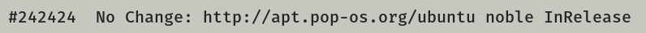
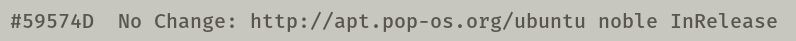
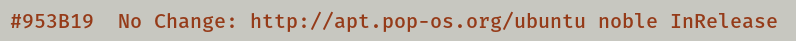
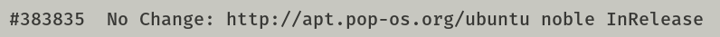

# COSMIC Terminal schemes

Colour schemes for COSMIC Terminal. The desktop `.ron` in `cosmic/` does not
colour ANSI text, so the terminal needs its own import.

1. COSMIC Terminal → **View → Color schemes…** (not Settings → Appearance)
2. **Light** tab → **Import** → a `.ron` from this folder
3. View → Settings → Appearance → Color scheme (light) → the scheme name

If a profile is set as default, set the scheme on that profile too or the
dropdown will look like it did nothing. `cosmic/install.sh` selects **Dossier**,
so import that one at least.

Every scheme here keeps the 16 ANSI colours of Dossier. Only the plain text
colour and the dim text change, so bat, lsd, starship, nala and btop look the
same whichever one you pick. The cursor stays orange  `#DE6A41`.

The ANSI slots follow the rice: `red` is red
 `#A80026`; `green` is olive
 `#51573B`; `yellow` is
rust, the accent  `#953B19`;
`blue` is khaki, the directory colour
 `#43432B`; `magenta` is
brown  `#754E3E`; `cyan` is
wine, the symlink colour 
`#6B1F2F`; `white` is muted 
`#59574D`. Directories are not affected: `LS_COLORS` in `zsh/dossier.zsh` colours
them in truecolor.

## Which one

Ink  `#242424` is the default. The others move through Dossier's own greys
and tints: calmer above it, brighter below it, for whoever finds the default
glares at night or reads too dim by day.

| Scheme | Plain text | Contrast | Also used for |
|--------|------------|----------|---------------|
| Dossier Muted |  `#59574D` | 4.3:1 | muted text, the dim text colour and the `white` slot |
| Dossier Khaki |  `#43432B` | 6.0:1 | directories (`LS_COLORS`), the `blue` slot |
| Dossier Olive |  `#51573B` | 4.5:1 | strings, success, the `green` slot |
| Dossier Rust |  `#953B19` | 4.2:1 | the accent, the `yellow` slot |
| Dossier Charcoal |  `#383835` | 6.9:1 | a neutral a step from plain text, the bright `black` slot |
| **Dossier** (default) |  `#242424` | 9.1:1 | the plain text colour of the rice |

When plain text shares a colour with an ANSI slot, output in that slot stops
standing out: directories in Dossier Khaki, for example, look like plain text.
Errors and numbers stand out more against the dimmer schemes than against
ink.

**Bold:** `bright_foreground` ( `#151515`) only colours bold text when
`use_bright_bold` is on. The baseline config in `cosmic/config/` leaves it off,
so bold text is the plain text colour at weight 800.

Previews are rendered in Fira Mono on the terminal background  `#C7C7C0`, not
taken from the terminal. In COSMIC you get Maple Mono on the opaque pane, so only the font differs.

## Light

**Dossier** · `Dossier-term.ron` · ink  `#242424`, 9.1:1. The default.

**Dossier Muted** · `Dossier-term-muted.ron` ·  `#59574D`, 4.3:1. Muted text, the dim text colour and the `white` slot.

**Dossier Khaki** · `Dossier-term-khaki.ron` ·  `#43432B`, 6.0:1. Directories (`LS_COLORS`), the `blue` slot.

**Dossier Olive** · `Dossier-term-olive.ron` ·  `#51573B`, 4.5:1. Strings, success, the `green` slot.

**Dossier Rust** · `Dossier-term-rust.ron` ·  `#953B19`, 4.2:1. The accent, the `yellow` slot.

**Dossier Charcoal** · `Dossier-term-charcoal.ron` ·  `#383835`, 6.9:1. A neutral a step from plain text, the bright `black` slot.

Contrast is plain text on the terminal background, WCAG 2.
