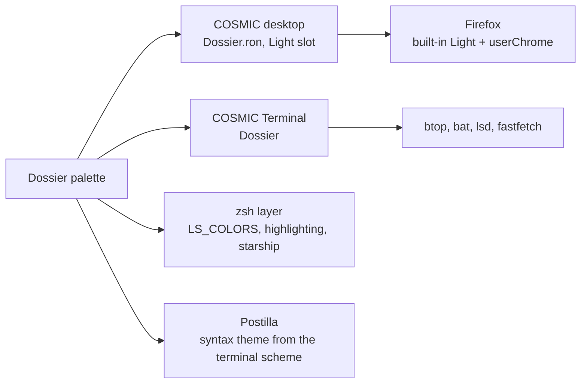

# Dossier

> Stone grey, olive and rust. The light half of Noir / Dossier.

Pop!_OS 24.04 on the COSMIC desktop, one palette carried through the whole
machine: desktop, terminal, shell, editor, browser. This note is the rice
describing itself, written in Markdown and rendered by **Postilla**.

## Palette

Every text colour is checked against the window background  `#D0D0C8`.

| Role | Hex | Contrast on background |
|------|-----|------------------------|
| Text |  `#242424` | 10.0:1 |
| Rust, accent |  `#953B19` | 4.6:1 |
| Orange, highlight |  `#DE6A41` | 2.2:1 |
| Olive, success |  `#51573B` | 4.9:1 |
| Brown, warning |  `#754E3E` | 4.6:1 |
| Red, error |  `#A80026` | 5.0:1 |
| Wine, symlinks |  `#6B1F2F` | 7.3:1 |

Containers sit one step away from the background at  `#DCDCD4`, which is
what frosted glass blurs into. The terminal is the exception: an opaque pane
at  `#C7C7C0`, a step darker than the desktop, as in the Omarchy original.

## Where the colours go



## Setup, in order

- [x] Import `cosmic/Dossier.ron` into Appearance, **Light** slot
- [x] Import `cosmic-term/Dossier-term.ron`, pick **Dossier** for the profile
- [x] `./icons/install.sh` for the **Cosmic-Dossier** icons, `./cosmic/install.sh` for fonts and the terminal look
- [x] `./zsh/install.sh`, `./lsd/install.sh`, `./fastfetch/install.sh`
- [x] Cursor: Oxygen-Dossier-Rust
- [x] Wallpaper: `backgrounds/dossier-eagle.png`
- [x] Screenshot for the README

## The baseline every rice shares

```ron
corner_radii: (
    radius_xs: (2.0, 2.0, 2.0, 2.0),   // squared corners
    radius_xl: (2.0, 2.0, 2.0, 2.0),
),
frosted: VeryLow,
frosted_windows: true,
frosted_panel: true,
frosted_applets: true,
frosted_maximized_apps: false,
gaps: (0, 7),
active_hint: 1,
```

Contrast is the WCAG ratio[^1], where $L$ is relative luminance:

```typst
$ (L_1 + 0.05) / (L_2 + 0.05) >= 4.5 $
```

---

*Rendered in Postilla, a Markdown notes app for COSMIC. The window is painted
with this rice's terminal scheme, imported as a syntax theme.*

[^1]: Web Content Accessibility Guidelines, success criterion 1.4.3. Normal text wants 4.5:1, large text 3:1.
